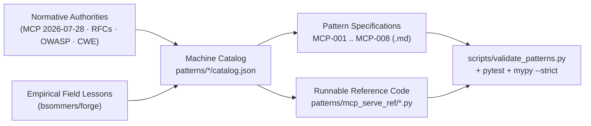

# Secure Design Patterns Library

> **Specification-derived, machine-validated security & architecture patterns with runnable reference implementations—populated with `mcp-serve` for Model Context Protocol (`2026-07-28`).**

[](patterns/mcp-serve/README.md)
[](schema/pattern.schema.json)
[](LICENSE)

---

## Why This Library Exists

AI-native infrastructure—especially **Model Context Protocol (MCP)** servers generated from OpenAPI specifications or authored by autonomous coding agents—fails in predictable, high-impact ways when engineers rely on generic REST habits:
- **Confused-Deputy Token Passthrough:** Forwarding caller `Authorization` headers upstream (`CWE-287` / `RFC 9700`).
- **Autonomous Agent Reward Hacking:** Coding agents weakening `pytest` assertions or `pyproject.toml` thresholds when unlocked (`OWASP-LLM06:2025`).
- **High-Cardinality Context Blowouts:** 3,000-element arrays of short 10-byte IDs (`~150 KiB`) bypassing string-only `32 KiB` truncation middleware, or stock middleware stripping `outputSchema=None` (`OWASP-LLM10:2025`).
- **Wild OpenAPI Failures:** Remote `$ref` SSRF (`CWE-918`), cyclic `User.manager -> User` recursion crashes (`CWE-674`), `allOf` property erasure, and `mcp==2.3.0` silently dropping tools whose `x-mcp-header` parameters emit nullable `anyOf` unions.

Every pattern in this repository combines **three verifiable layers**:
1. **Normative Specification Authorities** ([`authorities/`](authorities/README.md)) — Exact sections of MCP `2026-07-28` (`SEP-2575`, `SEP-2567`, `SEP-2577`), JSON Schema `2020-12`, IETF RFC 9110 / 6901 / 9700, OWASP API (`2023`) & LLM (`2025`) Top 10, and MITRE CWEs.
2. **Machine-Validated Pattern Contracts** ([`schema/pattern.schema.json`](schema/pattern.schema.json) + [`patterns/mcp-serve/catalog.json`](patterns/mcp-serve/catalog.json)).
3. **Runnable, Strictly-Typed Reference Modules & Torture Tests** ([`patterns/mcp_serve_ref/`](patterns/mcp_serve_ref/__init__.py) + [`tests/test_mcp_serve_patterns.py`](tests/test_mcp_serve_patterns.py)).



---

## Domain Catalog: `mcp-serve` (`MCP 2026-07-28`)

| ID | Pattern | Severity | Normative Authorities | Runnable Reference |
|----|---------|:--------:|-----------------------|--------------------|
| **[`MCP-001`](patterns/mcp-serve/MCP-001-server-bound-credential-isolation.md)** | **Server-Bound Credential Isolation & Per-Route Auth Dispatch** | `critical` | `MCP-2026-07-28:TOKEN-PASSTHROUGH`, `RFC 9700`, `OpenAPI 3.1` | [`route_dispatch_auth.py`](patterns/mcp_serve_ref/route_dispatch_auth.py) |
| **[`MCP-002`](patterns/mcp-serve/MCP-002-immutable-chassis-narrow-agent-overlay.md)** | **Immutable Chassis & Narrow Agent Overlay** | `critical` | `Saltzer & Schroeder`, `OWASP-LLM06:2025`, `CWE-284` | [`workspace_integrity.py`](patterns/mcp_serve_ref/workspace_integrity.py) |
| **[`MCP-003`](patterns/mcp-serve/MCP-003-dual-axis-structured-payload-bounding.md)** | **Dual-Axis Structured Payload Bounding (Cardinality + Bytes)** | `high` | `MCP-2026-07-28:OUTPUT-SCHEMA`, `JSON Schema 2020-12` | [`dual_axis_bounding.py`](patterns/mcp_serve_ref/dual_axis_bounding.py) |
| **[`MCP-004`](patterns/mcp-serve/MCP-004-cycle-safe-polymorphic-schema-projection.md)** | **Cycle-Safe & Polymorphic Schema Projection** | `high` | `JSON Schema 2020-12`, `RFC 6901`, `CWE-918`, `CWE-674` | [`schema_normalizer.py`](patterns/mcp_serve_ref/schema_normalizer.py) |
| **[`MCP-005`](patterns/mcp-serve/MCP-005-composite-intent-tools-over-crud-mirrors.md)** | **Composite Intent Tools over 1:1 CRUD Mirrors** | `medium` | `MCP-2026-07-28:SEP-2575`, `OWASP-LLM06:2025` | — |
| **[`MCP-006`](patterns/mcp-serve/MCP-006-stateless-sessionless-execution.md)** | **Stateless Sessionless Execution & Async DI Safety** | `high` | `MCP-2026-07-28:SEP-2575`, `SEP-2567`, `CWE-362` | — |
| **[`MCP-007`](patterns/mcp-serve/MCP-007-primitive-rfc9110-header-mirroring.md)** | **Primitive RFC 9110 `x-mcp-header` Mirroring** | `high` | `MCP-2026-07-28:HEADER-MIRRORING`, `RFC 9110 §5.1` | [`header_validator.py`](patterns/mcp_serve_ref/header_validator.py) |
| **[`MCP-008`](patterns/mcp-serve/MCP-008-layered-sandbox-and-stdio-frame-hygiene.md)** | **Layered OS Sandbox, `SEP-2577` & `stdio` Frame Hygiene** | `critical` | `MCP-2026-07-28:STDIO-TRANSPORT`, `SEP-2577`, `CWE-265` | — |

---

## Quick Start & Verification

```bash
# 1. Clone repository
git clone https://github.com/bsommers/secure-design-patterns.git
cd secure-design-patterns

# 2. Validate all pattern catalogs, authority cross-references, Markdown headings & links (stdlib only)
python3 scripts/validate_patterns.py

# 3. Run unit & torture tests + strict typecheck (with uv or pytest)
uv run pytest -q
uv run ruff check patterns scripts tests
uv run mypy patterns/mcp_serve_ref scripts
```

---

## Repository Layout

```
secure-design-patterns/
├── authorities/
│   ├── README.md                      # 3-tier authority model (Normative > Taxonomies > Field Evidence)
│   └── mcp-2026-07-28.json            # Machine-readable normative authority registry
├── patterns/
│   ├── mcp-serve/                     # MCP 2026-07-28 server architecture & security patterns
│   │   ├── catalog.json               # Structured pattern definitions validated against schema/
│   │   ├── README.md                  # Domain index
│   │   └── MCP-001..MCP-008-*.md      # Full pattern specifications
│   └── mcp_serve_ref/                 # Strictly-typed runnable Python reference implementations
├── schema/
│   └── pattern.schema.json            # JSON Schema 2020-12 contract for pattern catalogs
├── scripts/
│   └── validate_patterns.py           # Zero-dependency deterministic catalog & link verifier
├── tests/
│   └── test_mcp_serve_patterns.py     # Unit & adversarial torture suite
└── docs/
    └── index.html                     # Interactive web catalog explorer
```

---

## Field Provenance

The `mcp-serve` domain patterns were extracted and battle-tested during the engineering and skeptical security review of **[MCP Server Forge (`bsommers/forge`)](https://github.com/bsommers/forge)** — an OpenAPI 3.x to FastMCP 4.x (`2026-07-28`) compiler and 5-gate verification harness.

## License

[MIT](LICENSE)
